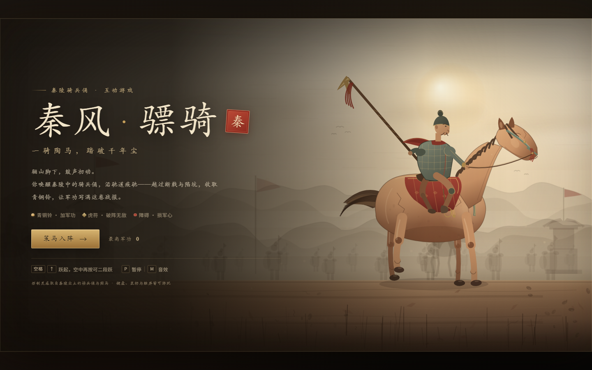

# 秦风 · 骠骑

一款以**秦陵骑兵俑与陶马**为灵感的网页跑酷小游戏。全部画面由 Canvas 2D 实时绘制，无任何外部依赖，打开 `index.html` 即可游玩。



## 运行

直接双击 `index.html`，或在本目录启动一个本地静态服务器：

```powershell
# 任选一种
python -m http.server 8000
npx serve .
```

然后访问 `http://localhost:8000`（用本地服务器打开时，浏览器对音效和本地存储的限制更少）。

> 建议横屏游玩。桌面浏览器体验最佳；手机横屏后会出现「跃」按钮。

## 操作

| 操作 | 按键 |
| --- | --- |
| 跃起 | `空格` / `↑` / `W` / 点击画面 / 触屏「跃」 |
| 空中再跃 | 在空中再按一次 |
| 暂停 / 继续 | `P` / `Esc` |
| 音效开关 | `M` 或右上角「音」 |
| 快速重开（结算界面） | `空格` / `Enter` / `R` |

按住跳跃键可以跳得更高；轻点则是小跳。

## 玩法

- **铜铃**：沿驰道收集，增加军功；连续收集会提升连收倍率，最高 `×5`。
- **虎符**：稀有道具，拾取后进入约 6 秒「破阵」状态，无敌并撞碎障碍。
- **障碍**：石块、断戟、陷坑。每碰一次损失一点军心，三点耗尽即结束本次驰行。
- **军功爵**：结算时按军功评定爵位，从「公士」直至「五大夫」。最高分保存在浏览器 `localStorage` 中。

## 文件

```
qin-cavalry/
├── index.html    页面结构与界面
├── style.css     视觉样式、菜单与结算界面
├── game.js       场景、角色、玩法、Canvas 渲染与 WebAudio 音效
├── icon.svg      站点图标
└── README.md
```

## 说明

- 角色与场景均采用扁平化、陶土色与青铜色的风格化绘制，灵感来自秦陵出土的骑兵俑、陶马及秦代军功爵制。
- 音效由 WebAudio 实时合成，首次点击「策马入阵」后才会启动。
- 项目只使用原生 HTML / CSS / JavaScript；无需构建步骤。
